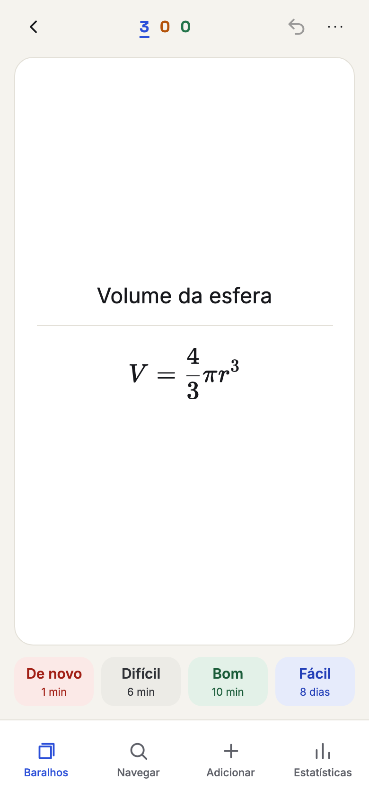
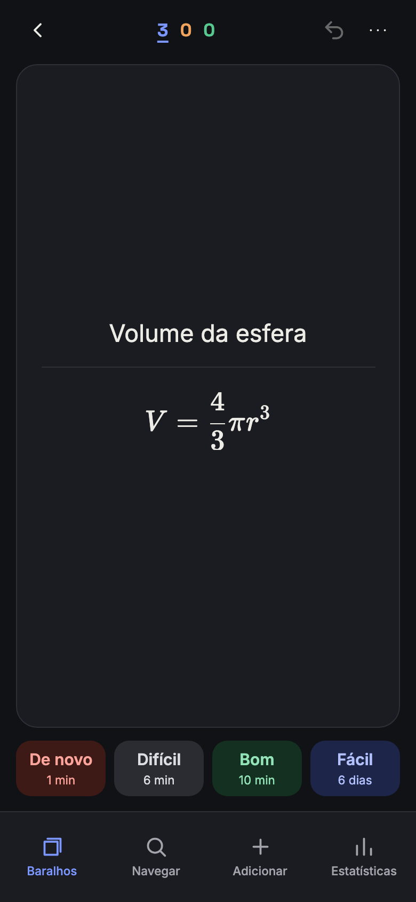

<p align="center">
  
</p>

<h1 align="center">Fixa</h1>

<p align="center">
  <strong>Spaced-repetition flashcards, built for your phone and for formulas.</strong><br>
  Works offline, keeps everything on your device and opens Anki decks.
</p>

<p align="center">
  <a href="https://hitaloose.github.io/fixa/"><strong>Open the app →</strong></a>
</p>

<p align="center">
  <a href="https://github.com/hitaloose/fixa/actions/workflows/ci.yml"></a>
  <a href="https://github.com/hitaloose/fixa/actions/workflows/deploy.yml"></a>
</p>

<p align="center">
  
  
  
  
  
</p>

## What it is

Fixa is an Anki-style flashcard app designed for studying on your phone. It schedules reviews with the **FSRS** algorithm, renders math with **KaTeX** and has a visual formula editor (**MathLive**). Fractions are stacked, just like in your notebook.

It's an installable web app (PWA): no account, no server, and it works without an internet connection. The interface is available in **Portuguese (Brazil)** and **English**.

## Features

- **Study with FSRS:** four buttons showing the next interval, keyboard shortcuts, swipe to answer, undo, bury, suspend and flag.
- **First-class formulas:** `\( … \)` and `\[ … \]` with KaTeX, a visual editor with a math keyboard, and cloze deletions inside formulas.
- **Decks and subdecks:** daily limits per preset, for this deck only, or for today only.
- **Note editor:** formatting, local images and audio, cloze, tags and preview.
- **Custom note types:** fields, cards, templates and CSS.
- **Card browser:** search syntax (`deck:`, `tag:`, `is:due`, `-negation`) and bulk actions.
- **Statistics:** true retention, streak, activity map and a 30-day workload simulation.
- **Custom study:** forgotten today, by tag, review ahead, or an infinite practice mode that doesn't touch scheduling.
- **Anki compatible:** imports `.apkg` and `.colpkg` (legacy and current formats), imports CSV/TXT and exports `.apkg`.
- **Dark mode**, following your device or your choice.
- **Portuguese or English**, picked in Settings → Language.

## Your data stays with you

There is no backend. Everything lives in the browser's IndexedDB.

- **File backup:** export whenever you want, or let automatic backup write to a folder (Chrome and Edge).
- **Two devices:** export from one and **merge** into the other. Reviews done on both sides are never lost.
- **Reminder:** the home screen tells you when your last backup is getting old.

## Install on your phone

Open [hitaloose.github.io/fixa](https://hitaloose.github.io/fixa/) and use **Add to Home screen** (Android) or **Share → Add to Home Screen** (iPhone).

On iPhone, install it before you start studying: Safari's data and the installed app's data are kept separate.

## Development

Requires Node 22 and pnpm 10. Versions are pinned in [`.tool-versions`](.tool-versions).

```bash
pnpm install
pnpm dev          # development server
pnpm check        # lint + layer rules + types + tests with coverage
pnpm test:e2e     # Playwright at 390×844
```

The project follows **strict TDD**: no production code goes in without a failing test first. Read [`CLAUDE.md`](CLAUDE.md) and [`docs/11-tdd.md`](docs/11-tdd.md) before contributing.

UI strings live in [`src/i18n`](src/i18n): `pt-BR.ts` is the reference and `en.ts` must have the same keys (a test and the `Messages` type enforce it). Every new string goes into both.

The screenshots above are generated by a script, with the app running via `pnpm build && pnpm preview`:

```bash
node scripts/screenshots.mjs
```

### Stack

React 19 · TypeScript · Vite · TanStack Router · Tailwind CSS v4 · Dexie (IndexedDB) · ts-fsrs · Tiptap · KaTeX · MathLive · sql.js · Vitest · Playwright · Stryker

### Documentation

The design docs are written in Portuguese.

- [Product and scope](docs/01-produto.md): screens and what goes into each phase
- [Stack and decisions](docs/02-stack.md): chosen libraries and why
- [Architecture](docs/03-arquitetura.md): layers, folders and dependency rules
- [Data model](docs/04-modelo-de-dados.md): entities and the IndexedDB schema
- [Scheduling (FSRS)](docs/05-agendamento.md): study queue, limits and algorithm
- [Data and backup](docs/06-dados-e-backup.md): persistence, backup and merging across devices
- [Formulas](docs/07-formulas.md): LaTeX, KaTeX and MathLive
- [Import and export](docs/08-import-export.md): Anki (`.apkg`) and CSV
- [Design](docs/09-design.md): colors, components, dark mode and branding
- [Roadmap](docs/10-roadmap.md): what's done and what's left
- [TDD](docs/11-tdd.md): how tests are written
