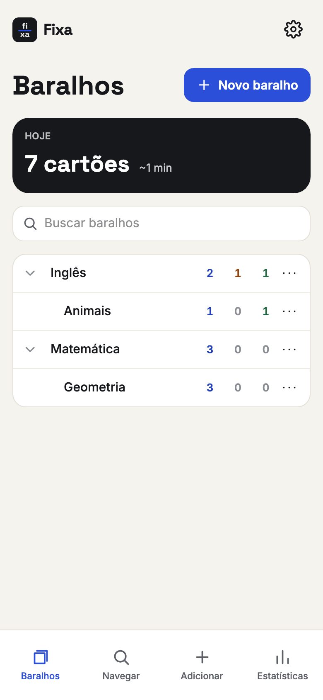
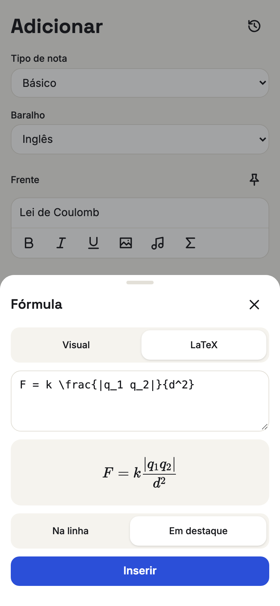
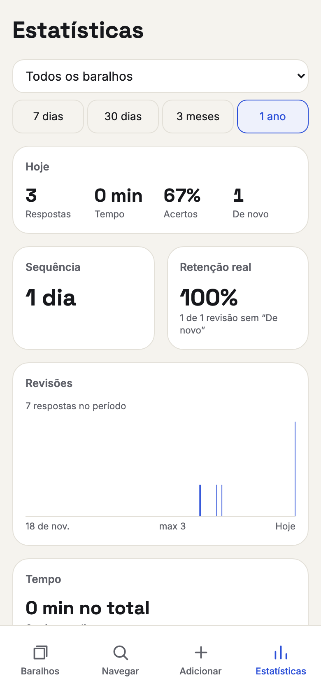

<p align="center">
  
</p>

<h1 align="center">Fixa</h1>

<p align="center">
  <strong>Flashcards com repetição espaçada, feitos para o celular e para fórmulas.</strong><br>
  Funciona offline, guarda tudo no seu aparelho e abre baralhos do Anki.
</p>

<p align="center">
  <a href="https://hitaloose.github.io/fixa/"><strong>Abrir o app →</strong></a>
</p>

<p align="center">
  <a href="https://github.com/hitaloose/fixa/actions/workflows/ci.yml"></a>
  <a href="https://github.com/hitaloose/fixa/actions/workflows/deploy.yml"></a>
</p>

<p align="center">
  
  
  
  
  
</p>

## O que é

O Fixa é um app de flashcards no estilo do Anki, pensado para estudar no celular. Ele agenda as revisões com o algoritmo **FSRS**, mostra fórmulas matemáticas com **KaTeX** e tem um editor visual de fórmulas (**MathLive**). Frações aparecem empilhadas, como no caderno.

É um app web instalável (PWA): não precisa de conta nem de servidor, e funciona sem internet.

## Recursos

- **Estudo com FSRS:** quatro botões com o próximo intervalo, atalhos de teclado, deslizar para responder, desfazer, enterrar, suspender e marcar.
- **Fórmulas de primeira classe:** `\( … \)` e `\[ … \]` com KaTeX, editor visual com teclado matemático e omissão dentro da fórmula.
- **Baralhos e subbaralhos:** limites diários por predefinição, só deste baralho ou só de hoje.
- **Editor de notas:** formatação, imagens e áudio locais, omissão (cloze), etiquetas e pré-visualização.
- **Tipos de nota personalizados:** campos, cartões, templates e CSS.
- **Navegador de cartões:** busca com sintaxe (`deck:`, `tag:`, `is:due`, `-negação`) e ações em massa.
- **Estatísticas:** retenção real, sequência, mapa de atividade e simulação da carga dos próximos 30 dias.
- **Estudo personalizado:** esquecidos hoje, por etiqueta ou adiantar revisões.
- **Compatível com o Anki:** importa `.apkg` e `.colpkg` (formato antigo e atual), importa CSV/TXT e exporta `.apkg`.
- **Modo escuro**, seguindo o aparelho ou a sua escolha.

## Seus dados ficam com você

Não existe backend. Tudo fica no IndexedDB do navegador.

- **Backup em arquivo:** exporte quando quiser, ou deixe o backup automático gravar numa pasta (Chrome e Edge).
- **Dois aparelhos:** exporte de um e **mescle** no outro. Revisões feitas nos dois lados não se perdem.
- **Lembrete:** a tela inicial avisa quando o último backup ficou velho.

## Instalar no celular

Abra [hitaloose.github.io/fixa](https://hitaloose.github.io/fixa/) e use **Adicionar à tela inicial** (Android) ou **Compartilhar → Adicionar à Tela de Início** (iPhone).

No iPhone, instale antes de começar a estudar: os dados do Safari e os do app instalado ficam separados.

## Desenvolvimento

Requer Node 22 e pnpm 10. As versões estão em [`.tool-versions`](.tool-versions).

```bash
pnpm install
pnpm dev          # servidor de desenvolvimento
pnpm check        # lint + regras de camadas + tipos + testes com cobertura
pnpm test:e2e     # Playwright em 390×844
```

O projeto segue **TDD estrito**: nenhum código de produção entra sem um teste falhando antes. Leia o [`CLAUDE.md`](CLAUDE.md) e o [`docs/11-tdd.md`](docs/11-tdd.md) antes de contribuir.

As capturas acima são geradas por script, com o app rodando em `pnpm build && pnpm preview`:

```bash
node scripts/screenshots.mjs
```

### Stack

React 19 · TypeScript · Vite · TanStack Router · Tailwind CSS v4 · Dexie (IndexedDB) · ts-fsrs · Tiptap · KaTeX · MathLive · sql.js · Vitest · Playwright · Stryker

### Documentação

| | |
|---|---|
| [Produto e escopo](docs/01-produto.md) | [Stack e decisões](docs/02-stack.md) |
| [Arquitetura](docs/03-arquitetura.md) | [Modelo de dados](docs/04-modelo-de-dados.md) |
| [Agendamento (FSRS)](docs/05-agendamento.md) | [Dados e backup](docs/06-dados-e-backup.md) |
| [Fórmulas](docs/07-formulas.md) | [Importação e exportação](docs/08-import-export.md) |
| [Design](docs/09-design.md) | [Roadmap](docs/10-roadmap.md) |
